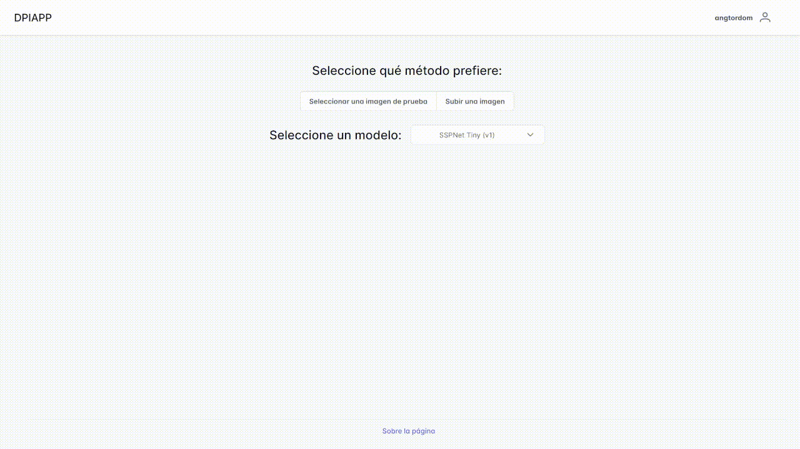
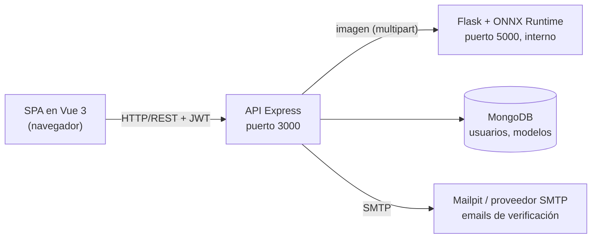

# DPIApp — Detección de Personas en Imágenes Aéreas

[English](README.md) · **Español**

Trabajo Fin de Grado (Universidad de Sevilla, 2022): detección de **personas diminutas** (de 2 a 20 píxeles de alto) en imágenes aéreas y de dron de gran campo de visión, una capacidad clave en búsqueda y rescate. El proyecto cubre todo el camino de la investigación a la producción: entrenamiento y evaluación de detectores en el benchmark TinyPerson, exportación a ONNX y despliegue mediante una API de inferencia y una aplicación web donde el usuario sube una imagen (o elige una de muestra), selecciona un modelo y obtiene el resultado anotado.



Los detectores se construyen sobre [MMDetection](https://github.com/open-mmlab/mmdetection) 2.19, combinando el framework del [Tiny Object Detection Challenge](https://github.com/ucas-vg/TinyBenchmark) con **SSPNet** (*Scale Selection Pyramid Network*).

---

## Resultados

Conjunto de test de [TinyPerson](https://github.com/ucas-vg/TinyBenchmark), métricas oficiales del challenge: AP con IoU 0,5 y 0,25 por rango de tamaño (tiny = 2–20 px, tiny1 = 2–8, tiny2 = 8–12, tiny3 = 12–20).

**Resultados del TFG (2022):**

| Modelo | AP50 tiny | AP50 tiny1 | AP50 tiny2 | AP50 tiny3 | AP25 tiny | Latencia (GPU) |
|---|---|---|---|---|---|---|
| SSPNet (v2) | **49,58** | **37,40** | **52,30** | **58,76** | 67,98 | 542,2 ms |
| SSPNet Tiny (v1) | 47,30 | 31,88 | 51,01 | 56,84 | **69,41** | 54,3 ms |
| Faster R-CNN R50-FPN Tiny (v1, referencia) | 28,74 | 17,11 | 33,24 | 36,70 | 44,96 | 56,9 ms |

- **v1** entrena a la escala original de la imagen; **v2** entrena con subimágenes, aumentos con Albumentations y reescalado multiescala (640×512 / 960×768), y evalúa cada recorte a dos escalas (1280×1024 y 1920×1536).
- SSPNet v2 gana 2,3 puntos de AP50 tiny a v1 a cambio de **10× más latencia**, que viene de las dos resoluciones ampliadas de test. SSPNet Tiny es el mejor equilibrio entre precisión y coste para servir el modelo.
- La latencia es por recorte de 640×512 (batch 1, herramienta de benchmark de MMDetection en una GPU de Google Colab). Las imágenes de test se dividen en recortes solapados (22,5 por imagen de media) cuyas detecciones se fusionan con NMS.

**Reproducción y ablación (2026).** Reevaluar los checkpoints originales con el entorno Docker de [api/app/Dockerfile.dev](api/app/Dockerfile.dev) reproduce las dos filas de SSPNet con un margen de 0,5 puntos de AP50 tiny (49,55 y 47,71) y la referencia con uno de 0,9 (29,56). Alcanza 44,46 de AP50 tiny (27,79 en tiny1): el cuello SSPNet aporta **+3,3 puntos de AP50 tiny y +4,3 en las personas más pequeñas (tiny1, 2–8 px)** a cambio de un tercio más de latencia en GPU (30,9 frente a 23,1 ms por recorte). 

**Modelos servidos (ONNX Runtime, CPU):**

| Modelo | AP50 tiny (ONNX) | Latencia CPU |
|---|---|---|
| SSPNet (v2) | n/d¹ | 1694 ms |
| SSPNet Tiny (v1) | 47,24 | 447 ms |
| Faster R-CNN R50-FPN (referencia de 2026) | 44,05 | 264 ms |

Por recorte de 640×512, batch 1, AMD Ryzen 5 9600X (6 hilos), ONNX Runtime 1.14. La exportación a ONNX sustituye soft-NMS por NMS estándar, lo que cuesta unos 0,5 puntos de AP50 tiny.
¹ El v2 exportado funciona a una sola escala (1280×1024) y sin aumentos en test, así que su precisión no es la de la tabla anterior; no se ha evaluado en el test completo.

## Enfoque

- **Datos:** TinyPerson (anotaciones en formato COCO). Las clases "sea person" y "earth person" se unen en una sola clase *person*; las regiones *uncertain* se borran, y las imágenes grandes se dividen en recortes solapados de 640×512 cuyas detecciones se vuelven a unir con NMS al evaluar.
- **Modelos:** Faster R-CNN R50-FPN como referencia, y Faster R-CNN con el cuello SSPNet (módulos de atención de contexto, realce de escala y selección de escala, más muestreo ponderado de negativos).
- **Entrenamiento:** ResNet-50 preentrenada en ImageNet, SGD con lr 0,0025 (batch 2), 12 épocas, dos regímenes de entrenamiento (v1/v2, ver arriba). Los modelos SSPNet se entrenaron en Google Colab Pro en 2022 (ver [notebooks/TFG_DPIApp_experimentos.ipynb](notebooks/TFG_DPIApp_experimentos.ipynb)); la referencia de la ablación se entrenó en local en 2026 con la misma receta.
- **Despliegue:** los modelos se exportan a ONNX y se sirven en CPU con ONNX Runtime. La aplicación web procesa cada imagen de una sola pasada a su resolución nativa, igual que se entrenaron v1 y la referencia; el protocolo de test multiescala ampliado de v2 no se reproduce en la aplicación.

## Limitaciones

- Cada modelo se ha entrenado una sola vez (sin repetir semillas), así que las diferencias pequeñas de AP están dentro del ruido.
- La aplicación procesa cada imagen de una vez y solo dibuja las cajas con una confianza de al menos 0,7; el AP de arriba se mide sobre recortes de 640×512 con todas las cajas por encima de 0,05. Por eso un resultado de la aplicación puede mostrar menos personas de las que encuentra el modelo.
- El protocolo de test multiescala de SSPNet v2 no se sirve; el v2 exportado funciona a una sola escala.
- En el stack de Docker la inferencia va en CPU: una imagen a resolución completa tarda segundos, y la muestra 4K bastante más.
- Los límites de peticiones y las cuotas se guardan en memoria, lo que basta para la única instancia de Express de este stack.

## Mi aportación

Adapté SSPNet sobre el framework de TinyBenchmark (MMDetection 2.19) y entrené tres detectores con transferencia de aprendizaje desde ImageNet. Diseñé dos regímenes de entrenamiento y evaluación (escala original frente a subimágenes con Albumentations y multiescala) y analicé el equilibrio entre precisión y latencia. Construí todo el sistema de despliegue: API de inferencia en Flask, aplicación web MEVN con autenticación y verificación por email, y tests unitarios, E2E y de carga. En el TFG funcionaba como un despliegue distribuido, con la aplicación web en Heroku y la API de inferencia en otra máquina detrás de Nginx con TLS de Let's Encrypt; este repositorio unifica ambas partes en un único stack de Docker Compose que se levanta en local con un solo comando.

La memoria completa del TFG (en español) está disponible bajo petición.

---

## Arquitectura del sistema



| Servicio | Tecnología | Función |
|---|---|---|
| `webapp` | Node.js + Express, Vue 3 + PrimeVue | API REST (autenticación, modelos, proxy de inferencia); sirve también la SPA compilada |
| `flask_api` | Flask + ONNX Runtime + pipelines de MMDetection | Inferencia (`/inference/<model>`), listado y subida de modelos |
| `database` | MongoDB 6 | Usuarios y modelos registrados |
| `mongo-express` | mongo-express | Panel de administración de MongoDB (puerto 8081, solo desde esta máquina) |
| `mailpit` | Mailpit | Servidor SMTP local que recoge los emails de verificación (interfaz web en el puerto 8025, solo desde esta máquina) |

Funcionalidades principales: autenticación con JWT (sesiones de 7 días) y contraseñas hasheadas con bcrypt, verificación de email por SMTP, gestión de modelos solo para administradores, imágenes de muestra, un visor del resultado con zoom y desplazamiento para las detecciones diminutas, descarga de resultados y una cuota de inferencias por usuario (2/minuto, 25/hora, 100/día). Seguridad: cabeceras de seguridad con Content Security Policy (helmet), CORS limitado al origen de la aplicación, validación en el servidor de todas las entradas (con los operadores de consulta de MongoDB neutralizados), tokens distintos para la sesión y para el enlace de verificación, la cuenta y el rol leídos de la base de datos en cada petición, como máximo 10 logins fallidos por cuenta e IP (100 por IP) cada 15 minutos, 10 registros por IP y hora, un único mensaje de error de login que no revela qué cuentas existen, respuestas de error genéricas, imágenes comprobadas por contenido y tamaño antes de decodificarlas, contenedores sin root, paneles de administración accesibles solo desde la máquina anfitriona y un servidor de inferencia que no recibe ningún secreto.

## Puesta en marcha

Requisitos: Docker y Docker Compose. Node.js ≥ 20 y Python 3.8 solo para desarrollo local.

```bash
cp .env.example .env
# define JWT_SECRET (Express no arranca con el valor de ejemplo) y MONGO_EXPRESS_PASSWORD, p. ej. con `openssl rand -hex 32`
docker compose up --build
```

Después regístrate en `http://localhost:3000`, abre el email de verificación en Mailpit (`http://localhost:8025`), inicia sesión, elige una imagen de muestra y un modelo y pulsa "Buscar personas".

| URL | Qué es |
|---|---|
| `http://localhost:3000` | La aplicación |
| `http://localhost:8025` | Mailpit: abre aquí el email de verificación después de registrarte (solo desde esta máquina) |
| `http://localhost:8081` | Panel de administración de MongoDB (`MONGO_EXPRESS_USER` / `MONGO_EXPRESS_PASSWORD`, solo desde esta máquina) |

> **Los pesos de los modelos** no se guardan en git. Descarga los modelos ONNX desde las GitHub Releases del proyecto en `api/app/configs/checkpoints/` (cada `<model>.onnx` va con su `api/app/configs/models/<model>.py`). En el primer arranque la aplicación registra todos los modelos que encuentra ahí. En Linux, el servidor de inferencia se ejecuta con el uid 1000 y escribe en esas carpetas los modelos subidos: si tu usuario tiene otro uid, ejecuta `sudo chown -R 1000:1000 api/app/configs/checkpoints api/app/configs/uploaded`.

Para gestionar modelos desde la aplicación, haz administrador a tu usuario con `docker compose exec webapp node scripts/makeAdmin.js <usuario>` (`--revoke` retira el rol) y vuelve a iniciar sesión. Los administradores suben solo los pesos ONNX y eligen a qué config del repositorio (arquitectura y preprocesado) pertenecen: las configs son Python que ejecuta el servidor de inferencia, así que solo vienen del repositorio, nunca de una subida. Los modelos subidos se guardan en `api/app/configs/checkpoints/` y `api/app/configs/uploaded/`.

Para desarrollar usa `docker compose -f docker-compose.dev.yml up`. Todo se ejecuta desde el código montado y se recarga al guardar: el servidor de desarrollo de Vue con recarga en caliente en `http://localhost:8080` (reenvía `/api` a Express), Express con nodemon en el puerto 3000 y Flask con recarga automática (sin el depurador interactivo) en el entorno de MMDetection de [api/app/Dockerfile.dev](api/app/Dockerfile.dev) (PyTorch 1.9 + CUDA 11.1, mmcv-full 1.5; necesita NVIDIA Container Toolkit) para entrenar, evaluar y exportar a ONNX. El primer arranque instala las dependencias de Node en volúmenes, lo que lleva uno o dos minutos. Todos sus puertos escuchan solo en esta máquina. Los dos stacks publican los mismos puertos, así que para uno (`docker compose down`) antes de arrancar el otro.

### Reproducir la evaluación

Con el dataset TinyPerson en `api/app/data/tinyPerson/` y los checkpoints de PyTorch en `api/app/configs/checkpoints/` (.pth, no publicados; disponibles bajo petición), ejecuta dentro del contenedor de desarrollo con GPU (`docker compose -f docker-compose.dev.yml run --rm flask_api sh`):

```bash
MODEL=faster_rcnn_r50_sspnet_1x_Tiny
python tools/test.py configs/models/$MODEL.py configs/checkpoints/$MODEL.pth --eval bbox   # AP (métricas de TinyPerson)
python tools/analysis_tools/benchmark_single_gpu.py configs/models/$MODEL.py configs/checkpoints/$MODEL.pth   # latencia GPU
python tools/train.py configs/models/$MODEL.py --work-dir work_dirs/$MODEL --seed 24 --no-validate   # reentrenar
docker compose -f docker-compose.dev.yml --profile convert run --rm convert                 # exportar todos los modelos a ONNX (desde el host)
CUDA_VISIBLE_DEVICES= python tools/analysis_tools/benchmark_onnx_cpu.py configs/models/$MODEL.py configs/checkpoints/$MODEL.onnx   # latencia CPU
```

`tools/deployment/test.py --backend onnxruntime --out preds.pkl` seguido de `tools/analysis_tools/eval_results.py` evalúa un modelo ONNX (la exportación rellena hasta 500 cajas por recorte, así que el script aplica antes el umbral de confianza de la config).

Desarrollo local sin Docker:

```bash
cd webapp && npm install && npm run dev            # Express, http://localhost:3000
cd webapp/client && npm install && npm run serve   # servidor de desarrollo de Vue, http://localhost:8080
```

## Configuración

Copia [.env.example](.env.example) a `.env`:

| Variable | Descripción |
|---|---|
| `APP_URL` | URL pública de la aplicación, usada en los emails de verificación (por defecto `http://localhost:3000`) |
| `WEB_SERVER_URL` | URL del servidor de inferencia Flask (por defecto `http://localhost:5000`; los stacks de Docker la definen ellos mismos) |
| `MONGODB_URI` | Cadena de conexión a MongoDB |
| `JWT_SECRET` | Secreto con el que se firman los JWT: un valor aleatorio de al menos 32 caracteres (si no, Express no arranca) |
| `CORS_ORIGINS` | Orígenes que pueden llamar a la API desde un navegador (separados por comas, por defecto `APP_URL`; añade `http://localhost:8080` para el servidor de desarrollo de Vue) |
| `TRUST_PROXY` | Número de proxies inversos delante de Express, para que los límites de peticiones vean la IP del cliente (sin definir en el stack de Docker) |
| `SMTP_HOST` / `SMTP_PORT` / `SMTP_SECURE` / `SMTP_USER` / `SMTP_PASS` | Servidor SMTP de los emails de verificación (por defecto el Mailpit incluido; en producción sirve cualquier proveedor) |
| `MAIL_FROM` | Remitente de los emails de verificación |
| `TEST_USER_USERNAME` / `TEST_USER_PASSWORD` | Usuario con el que inician sesión los tests unitarios, E2E y de carga (lo crean los propios tests; el nombre debe cumplir las reglas del registro) |
| `MONGO_EXPRESS_USER` / `MONGO_EXPRESS_PASSWORD` | Credenciales del panel de administración de MongoDB |

## API REST

| Método | Ruta | Descripción |
|---|---|---|
| `POST` | `/api/login` | Iniciar sesión con usuario/email y contraseña; devuelve un JWT |
| `POST` | `/api/users` | Registro (envía un email de verificación) |
| `GET` | `/api/users/verify/:token` | Verificar el email |
| `DELETE` | `/api/users/:username` | Eliminar tu propia cuenta (admins: cualquier cuenta) |
| `GET` | `/api/models` | Listar los modelos registrados |
| `POST` | `/api/models` | Subir un modelo ONNX y elegir la config del repositorio con la que se entrenó (admin) |
| `GET` | `/api/models/configs` | Configs del repositorio que puede usar un modelo subido (admin) |
| `GET` | `/api/models/flask` | Modelos disponibles en el servidor de inferencia (admin) |
| `DELETE` | `/api/models/:id` | Dar de baja un modelo: desaparece de la aplicación y se rechaza la inferencia con él; sus ficheros siguen en el servidor de inferencia (admin) |
| `POST` | `/api/inference/:model` | Inferencia sobre una imagen subida (JPG o PNG) |
| `POST` | `/api/inference/server/:model` | Inferencia sobre una imagen de muestra incluida |

Las rutas autenticadas esperan el JWT de sesión (lo devuelve `/api/login` en el cuerpo JSON como `token`) en una cabecera `token`; la inferencia lo exige y está limitada por usuario. Los errores llegan como `{"message": "..."}` con los códigos habituales (400 entrada no válida, 401 sin sesión, 403 no permitido, 404, 409 ya existe, 413 fichero demasiado grande, 429 límite alcanzado, 502 servidor de inferencia no disponible).

- `POST /api/login`: JSON `{"username": "<usuario o email>", "password": "..."}` → `{"userDB": {...}, "token": "<JWT>"}`.
- `POST /api/users`: JSON `{"username", "email", "password"}`; usuarios de 4 a 20 letras, dígitos, `.`, `_` o `-`, contraseñas de 8 a 72 caracteres.
- `POST /api/inference/:model`: formulario multipart con la imagen (JPG o PNG, como máximo 10 MB y 25 megapíxeles) en el campo `data`.
- `POST /api/inference/server/:model`: JSON `{"image": "images/<fichero>.jpg"}`, una de las muestras incluidas.
- Las dos rutas de inferencia responden `{"img": "<JPEG anotado en base64>"}`; las respuestas 429 llevan cabeceras `RateLimit` con la espera.

```bash
TOKEN=$(curl -s -X POST localhost:3000/api/login -H 'Content-Type: application/json' \
  -d '{"username":"<usuario>","password":"<contraseña>"}' | jq -r .token)
curl -s -X POST localhost:3000/api/inference/faster_rcnn_r50_sspnet_1x_Tiny -H "token: $TOKEN" \
  -F data=@imagen.jpg | jq -r .img | base64 -d > resultado.jpg
```

## Tests

Las baterías de tests se ejecutan en contenedores, así que solo hace falta Docker. [docker-compose.test.yml](docker-compose.test.yml) es un entorno aparte y autocontenido (su propia base de datos en memoria, Mailpit, servidor de inferencia y aplicación, sin puertos publicados): cada comando arranca lo que necesita su batería, muestra su salida y lo para todo al terminar, y puede ejecutarse con los stacks de la aplicación en marcha.

```bash
# Mocha + Chai (API)
docker compose -f docker-compose.test.yml --profile unit up --build --abort-on-container-exit --exit-code-from unit-tests --attach unit-tests
# Cypress: interfaz, registro con verificación por email, login, inferencia y visor del resultado
docker compose -f docker-compose.test.yml --profile e2e up --build --abort-on-container-exit --exit-code-from e2e-tests --attach e2e-tests
# Artillery: 7 minutos de logins, hasta 20 por segundo
docker compose -f docker-compose.test.yml --profile load up --build --abort-on-container-exit --exit-code-from load-tests --attach load-tests
docker compose -f docker-compose.test.yml down   # opcional: borra los contenedores parados
```

La aplicación que se prueba es una build de producción del código actual. Los usuarios de prueba tienen contraseñas conocidas, así que los tests unitarios solo se ejecutan sobre una base de datos cuyo nombre acabe en `_test` y el seed de los E2E ([tests/e2e/seed.js](webapp/tests/e2e/seed.js)) solo sobre una que acabe en `_e2e`. Las capturas de los fallos se guardan en `webapp/tests/e2e/cypress/screenshots/`. El test de carga falla si el p95 del login supera 500 ms o falla alguna petición.

Los tests del servidor de inferencia ([api/app/tests/test_app.py](api/app/tests/test_app.py): validación de imágenes, subida y listado de modelos, y una inferencia real si están los pesos) se ejecutan en el contenedor de desarrollo, o en cualquier entorno con `requirements.txt` y `requirements-test.txt`:

```bash
docker compose -f docker-compose.dev.yml exec flask_api python -m pytest
```

Sin Docker, las mismas baterías se ejecutan con `MONGODB_URI=mongodb://localhost/dpiapp_test npm run tests:unit`, `npm run tests:seed && npm run tests:e2e` y `npm run tests:load` desde `webapp/` (con MongoDB en marcha en local y la aplicación arrancada con `MONGODB_URI=mongodb://localhost/dpiapp_e2e`), y `npm run lint` desde `webapp/client/`.

## Estructura del proyecto

```
.
├── api/app/                  # API de inferencia en Flask + MMDetection (TinyBenchmark + SSPNet)
│   ├── app.py                # Recursos Inference, UploadModel, ModelList y ConfigList
│   ├── configs/              # Configs de modelos, datasets y calendarios (pesos ONNX fuera de git)
│   ├── mmdet/                # MMDetection 2.19 modificado
│   ├── huicv/                # Utilidades de evaluación de TinyPerson
│   ├── tests/                # Tests del servidor de inferencia (pytest)
│   └── tools/                # Scripts de entrenamiento, test y exportación
├── notebooks/                # Notebook de entrenamiento y evaluación (Colab)
├── webapp/
│   ├── client/               # SPA en Vue 3
│   ├── server/               # Rutas de Express, modelos de Mongoose, middleware JWT, scripts/makeAdmin.js
│   └── tests/                # unitarios (Mocha), e2e (Cypress), carga (Artillery)
├── docker-compose.yml        # Stack de producción
├── docker-compose.dev.yml    # Stack de desarrollo con GPU
└── docker-compose.test.yml   # Entorno de tests autocontenido
```

---

## Créditos y licencias

Este proyecto se distribuye bajo la [licencia Apache 2.0](LICENSE). Incluye o adapta código de terceros, cada uno con su propia licencia:

| Componente | Origen | Licencia |
|---|---|---|
| `api/app/mmdet/`, `tools/`, `configs/_base_/` | [MMDetection](https://github.com/open-mmlab/mmdetection) 2.19 vía [TOV_mmdetection](https://github.com/ucas-vg/TOV_mmdetection) | Apache 2.0 ([api/app/LICENSE](api/app/LICENSE)) |
| SSPNet (`mmdet/models/necks/ssfpn.py`, `mmdet/models/detectors/faster_rcnn_ssp.py`) | [SSPNet](https://github.com/MingboHong/SSPNet) | Apache 2.0 |
| `api/app/huicv/` | [huicv](https://github.com/yinglang/huicv) (utilidades de evaluación de TinyBenchmark) | MIT ([api/app/huicv/LICENSE](api/app/huicv/LICENSE)) |
| Interfaz de `webapp/client/` | Plantilla [Sakai Vue](https://github.com/primefaces/sakai-vue) de PrimeTek | MIT ([webapp/client/LICENSE.md](webapp/client/LICENSE.md)) |

El dataset [TinyPerson](https://github.com/ucas-vg/TinyBenchmark) no se incluye; descárgalo desde su fuente oficial. Las cinco imágenes de muestra de `webapp/client/public/images/` proceden de TinyPerson para demostrar la aplicación; sus derechos pertenecen a los autores del dataset.

### Referencias

- Hong, M. et al. *SSPNet: Scale Selection Pyramid Network for Tiny Person Detection From UAV Images.* IEEE GRSL, 2021.
- Yu, X. et al. *Scale Match for Tiny Person Detection.* WACV, 2020.
- Yu, X. et al. *The 1st Tiny Object Detection Challenge: Methods and Results.* ECCV Workshops, 2020.
- Chen, K. et al. *MMDetection: Open MMLab Detection Toolbox and Benchmark.* arXiv:1906.07155, 2019.

### Cita

Para citar este trabajo, usa los metadatos de [CITATION.cff](CITATION.cff).
