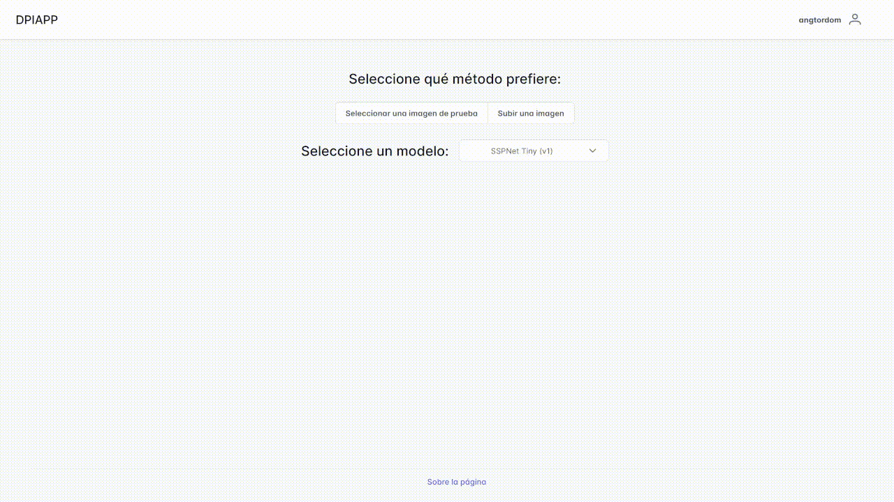
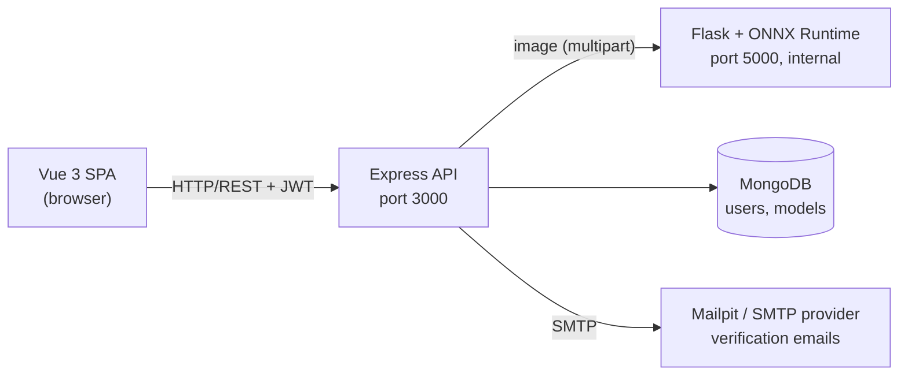

# DPIApp — Tiny Person Detection in Aerial Images

**English** · [Español](README.es.md)

Bachelor's thesis project (University of Seville, 2022): detecting **tiny people** (2–20 pixels tall) in wide-view aerial and drone images, a key capability for search-and-rescue. The project covers the full path from research to production: training and evaluating detectors on the TinyPerson benchmark, exporting them to ONNX, and serving them through an inference API and a web app where users upload an image (or pick a sample), choose a model and get the annotated result.



Detectors are built on [MMDetection](https://github.com/open-mmlab/mmdetection) 2.19, combining the [Tiny Object Detection Challenge](https://github.com/ucas-vg/TinyBenchmark) framework with **SSPNet** (*Scale Selection Pyramid Network*).

---

## Results

[TinyPerson](https://github.com/ucas-vg/TinyBenchmark) test set, official challenge metrics: AP at IoU 0.5 and 0.25 per object-size range (tiny = 2–20 px, tiny1 = 2–8, tiny2 = 8–12, tiny3 = 12–20).

**Thesis results (2022):**

| Model | AP50 tiny | AP50 tiny1 | AP50 tiny2 | AP50 tiny3 | AP25 tiny | Latency (GPU) |
|---|---|---|---|---|---|---|
| SSPNet (v2) | **49.58** | **37.40** | **52.30** | **58.76** | 67.98 | 542.2 ms |
| SSPNet Tiny (v1) | 47.30 | 31.88 | 51.01 | 56.84 | **69.41** | 54.3 ms |
| Faster R-CNN R50-FPN Tiny (v1, baseline) | 28.74 | 17.11 | 33.24 | 36.70 | 44.96 | 56.9 ms |

- **v1** trains at the original image scale; **v2** trains on sub-images with Albumentations augmentation and multi-scale resizing (640×512 / 960×768), and tests every crop at two scales (1280×1024 and 1920×1536).
- SSPNet v2 gains 2.3 AP50-tiny points over v1 at **10× the latency**, which comes from the two upscaled test resolutions. SSPNet Tiny is the best accuracy/cost trade-off for serving.
- Latency is per 640×512 crop (batch 1, MMDetection's benchmark tool on a Google Colab GPU). Test images are split into overlapping crops (22.5 per image on average) whose detections are merged with NMS.

**Reproduction and ablation (2026).** Re-evaluating the original checkpoints with the Docker environment in [api/app/Dockerfile.dev](api/app/Dockerfile.dev) reproduces both SSPNet rows within 0.5 AP50 tiny (49.55 and 47.71) and the baseline within 0.9 (29.56). It reaches 44.46 AP50 tiny (27.79 on tiny1): the SSPNet neck adds **+3.3 AP50 tiny and +4.3 on the smallest people (tiny1, 2–8 px)** for about a third more GPU latency (30.9 vs 23.1 ms per crop). Each model was trained once, so small gaps should not be over-read.

**Served models (ONNX Runtime, CPU):**

| Model | AP50 tiny (ONNX) | CPU latency |
|---|---|---|
| SSPNet (v2) | n/a¹ | 1694 ms |
| SSPNet Tiny (v1) | 47.24 | 447 ms |
| Faster R-CNN R50-FPN (2026 baseline) | 44.05 | 264 ms |

Per 640×512 crop, batch 1, AMD Ryzen 5 9600X (6 threads), ONNX Runtime 1.14. The ONNX export replaces soft-NMS with standard NMS, which costs about 0.5 AP50 tiny.
¹ The exported v2 runs a single scale (1280×1024) without test-time augmentation, so its accuracy is not that of the table above; it was not evaluated on the full test set.

## Approach

- **Data:** TinyPerson (COCO-format annotations). "Sea person" and "earth person" are merged into a single *person* class; *uncertain* regions are erased, and large images are split into overlapping 640×512 crops whose detections are merged back with NMS at evaluation time.
- **Models:** Faster R-CNN R50-FPN as baseline, and Faster R-CNN with the SSPNet neck (context attention, scale enhancement and scale selection modules, plus weighted negative sampling).
- **Training:** ImageNet-pretrained ResNet-50, SGD with lr 0.0025 (batch 2), 12 epochs, two training regimes (v1/v2 above). The SSPNet models were trained on Google Colab Pro in 2022 (see [notebooks/TFG_DPIApp_experimentos.ipynb](notebooks/TFG_DPIApp_experimentos.ipynb)); the ablation baseline was trained locally in 2026 with the same recipe.
- **Serving:** the models are exported to ONNX and served on CPU with ONNX Runtime. The web app runs each image in one pass at its native resolution, which matches how v1 and the baseline were trained; v2's upscaled multi-scale test protocol is not reproduced in the app.

## Limitations

- Each model was trained once (no repeated seeds), so small AP differences are within noise.
- The app runs each image in one pass and draws only boxes with a score of at least 0.7; the AP above is measured on 640×512 crops with every box above 0.05. A result in the app can therefore show fewer people than the model finds.
- SSPNet v2's multi-scale test protocol is not served; the exported v2 runs at a single scale.
- Inference runs on CPU in the Docker stack: a full-resolution image takes seconds, and the 4K sample noticeably longer.
- Rate limits and quotas are kept in memory, which is enough for the single Express instance of this stack.

## My contribution

I adapted SSPNet on top of the TinyBenchmark framework (MMDetection 2.19) and trained three detectors with transfer learning from ImageNet. I designed two training and evaluation regimes (original scale vs. sub-image crops with Albumentations and multi-scale) and analysed the accuracy/latency trade-off. I built the whole serving stack: a Flask inference API, a MEVN web app with authentication and email verification, and unit, end-to-end and load tests. In the thesis it ran as a distributed deployment, with the web app on Heroku and the inference API on a separate machine behind Nginx with Let's Encrypt TLS; this repository unifies both into a single Docker Compose stack that runs locally with one command.

The full thesis report (in Spanish) is available on request.

---

## System architecture



| Service | Stack | Role |
|---|---|---|
| `webapp` | Node.js + Express, Vue 3 + PrimeVue | REST API (auth, models, inference proxy); also serves the built SPA |
| `flask_api` | Flask + ONNX Runtime + MMDetection pipelines | Inference (`/inference/<model>`), model listing and upload |
| `database` | MongoDB 6 | Users and registered models |
| `mongo-express` | mongo-express | MongoDB admin UI (port 8081, this machine only) |
| `mailpit` | Mailpit | Local SMTP server that catches the verification emails (web UI on port 8025, this machine only) |

Key features: JWT authentication (7-day sessions) with bcrypt-hashed passwords, email verification over SMTP, admin-only model management, sample images, a result viewer with zoom and pan for the tiny detections, downloadable results and a per-user inference quota (2/minute, 25/hour, 100/day). Hardening: security headers with a Content Security Policy (helmet), CORS limited to the app's origin, server-side validation of every input (with MongoDB query operators neutralised), separate tokens for sessions and verification links, the account and role read from the database on every request, at most 10 failed logins per account and IP (100 per IP) every 15 minutes, 10 sign-ups per IP and hour, a single login error message that does not reveal which accounts exist, generic error responses, images checked by content and size before decoding, non-root containers, admin panels reachable from the host only, and an inference server that receives no secrets.

## Getting started

Requirements: Docker and Docker Compose. Node.js ≥ 20 and Python 3.8 only for local development.

```bash
cp .env.example .env
# set JWT_SECRET (Express refuses the placeholder) and MONGO_EXPRESS_PASSWORD, e.g. with `openssl rand -hex 32`
docker compose up --build
```

Then sign up at `http://localhost:3000`, open the verification email in Mailpit (`http://localhost:8025`), log in, pick a sample image and a model, and press "Buscar personas".

| URL | What |
|---|---|
| `http://localhost:3000` | The app |
| `http://localhost:8025` | Mailpit: open the verification email here after signing up (this machine only) |
| `http://localhost:8081` | MongoDB admin UI (`MONGO_EXPRESS_USER` / `MONGO_EXPRESS_PASSWORD`, this machine only) |

> **Model weights** are not stored in git. Download the ONNX models from the project's GitHub Releases into `api/app/configs/checkpoints/` (each `<model>.onnx` pairs with `api/app/configs/models/<model>.py`). On first start the app registers every model it finds there. On Linux, the inference server runs as uid 1000 and writes uploaded models to those folders: if your user has another uid, run `sudo chown -R 1000:1000 api/app/configs/checkpoints api/app/configs/uploaded`.

To manage models from the app, make your user an administrator with `docker compose exec webapp node scripts/makeAdmin.js <username>` (`--revoke` takes the role back) and log in again. Administrators upload only the ONNX weights and choose which repository config (architecture and preprocessing) they belong to: configs are Python that the inference server executes, so they only come from the repository, never from an upload. Uploaded models are stored in `api/app/configs/checkpoints/` and `api/app/configs/uploaded/`.

For development use `docker compose -f docker-compose.dev.yml up`. Everything runs from the mounted source and reloads on save: the Vue dev server with hot reload at `http://localhost:8080` (it forwards `/api` to Express), Express under nodemon on port 3000, and Flask with auto-reload (without the interactive debugger) in the MMDetection environment from [api/app/Dockerfile.dev](api/app/Dockerfile.dev) (PyTorch 1.9 + CUDA 11.1, mmcv-full 1.5; requires the NVIDIA Container Toolkit) for training, evaluation and ONNX export. The first start installs the Node dependencies into volumes, which takes a minute or two. All its ports listen on this machine only. Both stacks publish the same ports, so stop one (`docker compose down`) before starting the other.

### Reproducing the evaluation

With the TinyPerson dataset under `api/app/data/tinyPerson/` and the PyTorch checkpoints in `api/app/configs/checkpoints/` (.pth, not published; available on request), run inside the GPU development container (`docker compose -f docker-compose.dev.yml run --rm flask_api sh`):

```bash
MODEL=faster_rcnn_r50_sspnet_1x_Tiny
python tools/test.py configs/models/$MODEL.py configs/checkpoints/$MODEL.pth --eval bbox   # AP (TinyPerson metrics)
python tools/analysis_tools/benchmark_single_gpu.py configs/models/$MODEL.py configs/checkpoints/$MODEL.pth   # GPU latency
python tools/train.py configs/models/$MODEL.py --work-dir work_dirs/$MODEL --seed 24 --no-validate   # retrain
docker compose -f docker-compose.dev.yml --profile convert run --rm convert                 # export all models to ONNX (from the host)
CUDA_VISIBLE_DEVICES= python tools/analysis_tools/benchmark_onnx_cpu.py configs/models/$MODEL.py configs/checkpoints/$MODEL.onnx   # CPU latency
```

`tools/deployment/test.py --backend onnxruntime --out preds.pkl` followed by `tools/analysis_tools/eval_results.py` evaluates an ONNX model (the export pads to 500 boxes per crop, so the script applies the config's score threshold first).

Local development without Docker:

```bash
cd webapp && npm install && npm run dev            # Express, http://localhost:3000
cd webapp/client && npm install && npm run serve   # Vue dev server, http://localhost:8080
```

## Configuration

Copy [.env.example](.env.example) to `.env`:

| Variable | Description |
|---|---|
| `APP_URL` | Public app URL, used in verification emails (default `http://localhost:3000`) |
| `WEB_SERVER_URL` | URL of the Flask inference server (default `http://localhost:5000`; the Docker stacks set it themselves) |
| `MONGODB_URI` | MongoDB connection string |
| `JWT_SECRET` | JWT signing secret: a random value of at least 32 characters (Express does not start otherwise) |
| `CORS_ORIGINS` | Origins allowed to call the API from a browser (comma-separated, defaults to `APP_URL`; add `http://localhost:8080` for the Vue dev server) |
| `TRUST_PROXY` | Number of reverse proxies in front of Express, so the rate limits see the client IP (unset in the Docker stack) |
| `SMTP_HOST` / `SMTP_PORT` / `SMTP_SECURE` / `SMTP_USER` / `SMTP_PASS` | SMTP server for the verification emails (defaults to the bundled Mailpit; any provider works in production) |
| `MAIL_FROM` | Sender of the verification emails |
| `TEST_USER_USERNAME` / `TEST_USER_PASSWORD` | User the unit, E2E and load tests log in with (created by the tests; the name must follow the sign-up rules) |
| `MONGO_EXPRESS_USER` / `MONGO_EXPRESS_PASSWORD` | MongoDB admin UI credentials |

## REST API

| Method | Route | Description |
|---|---|---|
| `POST` | `/api/login` | Log in with username/email and password; returns a JWT |
| `POST` | `/api/users` | Register (sends a verification email) |
| `GET` | `/api/users/verify/:token` | Verify email |
| `DELETE` | `/api/users/:username` | Delete your own account (admins: any account) |
| `GET` | `/api/models` | List registered models |
| `POST` | `/api/models` | Upload an ONNX model and pick the repository config it was trained with (admin) |
| `GET` | `/api/models/configs` | Repository configs an uploaded model can use (admin) |
| `GET` | `/api/models/flask` | Models available on the inference server (admin) |
| `DELETE` | `/api/models/:id` | Unregister a model: it leaves the app and inference with it is refused; its files stay on the inference server (admin) |
| `POST` | `/api/inference/:model` | Run inference on an uploaded image (JPG or PNG) |
| `POST` | `/api/inference/server/:model` | Run inference on a bundled sample image |

Authenticated routes expect the session JWT (returned by `/api/login` in the JSON body as `token`) in a `token` header; inference requires it and is limited per user. Errors come as `{"message": "..."}` with the usual status codes (400 invalid input, 401 no session, 403 not allowed, 404, 409 already taken, 413 file too large, 429 limit reached, 502 inference server unavailable).

- `POST /api/login`: JSON `{"username": "<username or email>", "password": "..."}` → `{"userDB": {...}, "token": "<JWT>"}`.
- `POST /api/users`: JSON `{"username", "email", "password"}`; usernames of 4-20 letters, digits, `.`, `_` or `-`, passwords of 8-72 characters.
- `POST /api/inference/:model`: multipart form with the image (JPG or PNG, at most 10 MB and 25 megapixels) in the `data` field.
- `POST /api/inference/server/:model`: JSON `{"image": "images/<file>.jpg"}`, one of the bundled samples.
- Both inference routes answer `{"img": "<annotated JPEG in base64>"}`; 429 responses carry `RateLimit` headers with the wait.

```bash
TOKEN=$(curl -s -X POST localhost:3000/api/login -H 'Content-Type: application/json' \
  -d '{"username":"<user>","password":"<password>"}' | jq -r .token)
curl -s -X POST localhost:3000/api/inference/faster_rcnn_r50_sspnet_1x_Tiny -H "token: $TOKEN" \
  -F data=@image.jpg | jq -r .img | base64 -d > result.jpg
```

## Tests

The test suites run in containers, so only Docker is needed. [docker-compose.test.yml](docker-compose.test.yml) is a separate, self-contained environment (its own in-memory database, mail catcher, inference server and app, nothing published): each command starts what its suite needs, shows the suite's output and stops everything when it ends, and it can run while the app's stacks are up.

```bash
# Mocha + Chai (API)
docker compose -f docker-compose.test.yml --profile unit up --build --abort-on-container-exit --exit-code-from unit-tests --attach unit-tests
# Cypress: UI, sign-up with email verification, login, inference and the result viewer
docker compose -f docker-compose.test.yml --profile e2e up --build --abort-on-container-exit --exit-code-from e2e-tests --attach e2e-tests
# Artillery: 7 minutes of logins ramping up to 20 per second
docker compose -f docker-compose.test.yml --profile load up --build --abort-on-container-exit --exit-code-from load-tests --attach load-tests
docker compose -f docker-compose.test.yml down   # optional: remove the stopped containers
```

The app under test is a production build of the current source. The test users have known passwords, so the unit tests only run on a database whose name ends in `_test` and the E2E seed ([tests/e2e/seed.js](webapp/tests/e2e/seed.js)) only on one ending in `_e2e`. Failure screenshots are saved to `webapp/tests/e2e/cypress/screenshots/`. The load test fails if the p95 login time goes over 500 ms or any request fails.

The inference server's tests ([api/app/tests/test_app.py](api/app/tests/test_app.py): image validation, model upload and listing, and a real inference when the weights are present) run in the development container, or in any environment with `requirements.txt` and `requirements-test.txt`:

```bash
docker compose -f docker-compose.dev.yml exec flask_api python -m pytest
```

Without Docker, the same suites run with `MONGODB_URI=mongodb://localhost/dpiapp_test npm run tests:unit`, `npm run tests:seed && npm run tests:e2e` and `npm run tests:load` from `webapp/` (with MongoDB running locally and the app started with `MONGODB_URI=mongodb://localhost/dpiapp_e2e`), and `npm run lint` from `webapp/client/`.

## Project structure

```
.
├── api/app/                  # Flask inference API + MMDetection (TinyBenchmark + SSPNet)
│   ├── app.py                # Inference, UploadModel, ModelList and ConfigList resources
│   ├── configs/              # Model, dataset and schedule configs (ONNX weights not in git)
│   ├── mmdet/                # Modified MMDetection 2.19
│   ├── huicv/                # TinyPerson evaluation utilities
│   ├── tests/                # Tests of the inference server (pytest)
│   └── tools/                # Train / test / export scripts
├── notebooks/                # Training and evaluation notebook (Colab)
├── webapp/
│   ├── client/               # Vue 3 SPA
│   ├── server/               # Express routes, Mongoose models, JWT middleware, scripts/makeAdmin.js
│   └── tests/                # unit (Mocha), e2e (Cypress), load (Artillery)
├── docker-compose.yml        # Production stack
├── docker-compose.dev.yml    # Development stack with GPU
└── docker-compose.test.yml   # Self-contained test environment
```

---

## Credits and licenses

This project is released under the [Apache 2.0 license](LICENSE). It includes or adapts third-party code, each under its own license:

| Component | Origin | License |
|---|---|---|
| `api/app/mmdet/`, `tools/`, `configs/_base_/` | [MMDetection](https://github.com/open-mmlab/mmdetection) 2.19 via [TOV_mmdetection](https://github.com/ucas-vg/TOV_mmdetection) | Apache 2.0 ([api/app/LICENSE](api/app/LICENSE)) |
| SSPNet (`mmdet/models/necks/ssfpn.py`, `mmdet/models/detectors/faster_rcnn_ssp.py`) | [SSPNet](https://github.com/MingboHong/SSPNet) | Apache 2.0 |
| `api/app/huicv/` | [huicv](https://github.com/yinglang/huicv) (TinyBenchmark evaluation utilities) | MIT ([api/app/huicv/LICENSE](api/app/huicv/LICENSE)) |
| `webapp/client/` UI | [Sakai Vue](https://github.com/primefaces/sakai-vue) template by PrimeTek | MIT ([webapp/client/LICENSE.md](webapp/client/LICENSE.md)) |

The [TinyPerson](https://github.com/ucas-vg/TinyBenchmark) dataset is not included; download it from its official source. The five sample images in `webapp/client/public/images/` are taken from TinyPerson to demonstrate the app; their rights belong to the dataset's authors.

### References

- Hong, M. et al. *SSPNet: Scale Selection Pyramid Network for Tiny Person Detection From UAV Images.* IEEE GRSL, 2021.
- Yu, X. et al. *Scale Match for Tiny Person Detection.* WACV, 2020.
- Yu, X. et al. *The 1st Tiny Object Detection Challenge: Methods and Results.* ECCV Workshops, 2020.
- Chen, K. et al. *MMDetection: Open MMLab Detection Toolbox and Benchmark.* arXiv:1906.07155, 2019.

### Citation

To cite this work, use the metadata in [CITATION.cff](CITATION.cff).
